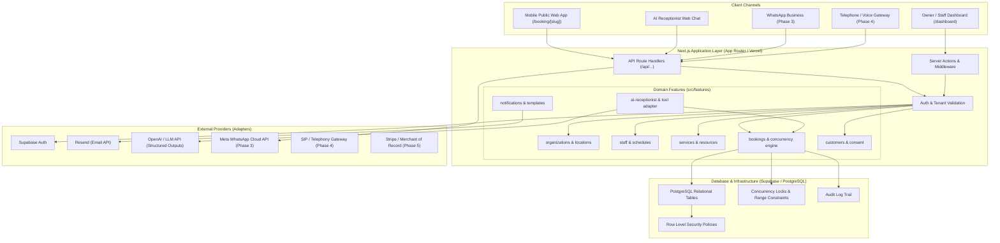
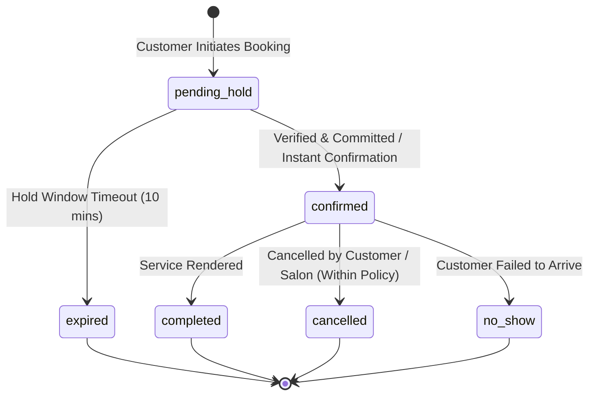

# BookPilot AI — System Architecture & Technical Specifications

> **Document Version:** 1.0  
> **Phase:** Phase 0 (Discovery & Specification)  
> **Status:** Planning Baseline — Approved for Phase 0  
> **Governing Standards:** [AGENTS.md](file:///c:/laragon/www/Ai%20Salon%20software/AGENTS.md) & [BOOKPILOT_PROJECT_MASTER_PLAN.md](file:///c:/laragon/www/Ai%20Salon%20software/BOOKPILOT_PROJECT_MASTER_PLAN.md)

---

## 1. System Overview & Core Philosophy

**BookPilot AI** is a multi-tenant appointment-booking and AI receptionist Software-as-a-Service (SaaS). It is engineered specifically for appointment-based service businesses, launching initially for independent barbershops and hair salons (1–10 staff members), with a domain model that generalizes to spas, nail studios, tutors, and consultants.

The platform is designed around three architectural pillars:
1. **Single Source of Truth Booking Core**: All customer interaction channels—the public mobile booking web app, the AI website receptionist, WhatsApp messaging, and future telephone voice channels—interact with the exact same centralized booking engine and PostgreSQL database. Channel connectors do not execute bespoke booking calculations.
2. **Deterministic Booking Correctness**: The AI receptionist model interprets natural language and extracts intent, but **all business logic, availability queries, policy evaluations, and appointment commitments are executed by deterministic server-side tools**. The AI cannot guess slots, alter prices, or confirm an appointment without a committed database transaction.
3. **Rigorous Tenant Isolation & Defense-in-Depth**: Every data record is strictly bound to an `organization_id`. Authorization is validated server-side on every request and reinforced with PostgreSQL Row Level Security (RLS). Client-side filtering is never relied upon for data boundaries.

---

## 2. High-Level System Architecture



---

## 3. Technology Stack Specification

| Component | Selected Technology | Technical Rationale & Boundaries |
|---|---|---|
| **Framework** | Next.js (App Router, React 19, TypeScript) | Unified full-stack architecture, SSR/SSG for public SEO booking pages, secure Server Components & Actions. |
| **Styling & UI** | Tailwind CSS + Accessible Radix/shadcn UI | Mobile-first responsive styling, high contrast, WCAG 2.1 AA accessibility, keyboard navigable. |
| **Database** | PostgreSQL 15+ (hosted on Supabase) | ACID compliance, `tstzrange` types for temporal booking calculations, transaction isolation, exclusion constraints. |
| **Authentication** | Supabase Auth | Secure session tokens, PKCE flow, multi-factor support, JWT claims with organization memberships. |
| **Authorization** | Server-side RBAC + PostgreSQL RLS | Mandatory server-side membership check on every endpoint + database RLS as defense-in-depth. |
| **AI Runtime** | Server-side adapter with Function/Tool Calling | Node.js runtime with strict JSON schema validation (Zod); no raw SQL or unbounded prompt execution. |
| **Notifications** | Resend (Transactional Email API) | High deliverability, template support, asynchronous queue with retry status logging. |
| **Hosting (Web)** | Vercel | Global edge routing, automatic SSL, preview environments. |
| **Hosting (Workers/Voice)** | Dedicated container / Persistent gateway (Later phases) | Telephony WebSockets and voice streaming require stateful persistent servers, not short-lived serverless functions. |

---

## 4. Repository Structure & Modular Domain Design

In accordance with Section 4 of `AGENTS.md`, the codebase follows a modular domain structure:

```text
src/
├── app/                                # Next.js App Router
│   ├── (auth)/                         # Login, registration, password recovery, verification
│   │   ├── login/
│   │   ├── register/
│   │   └── callback/
│   ├── (marketing)/                    # Public marketing, value proposition, SEO landing
│   ├── booking/
│   │   └── [businessSlug]/             # Public mobile-first booking experience
│   │       ├── page.tsx
│   │       ├── confirmation/
│   │       └── manage/                 # Secure tokenized booking cancellation/rescheduling
│   ├── dashboard/                      # Authenticated salon management portal
│   │   ├── layout.tsx
│   │   ├── page.tsx                    # Today's appointments & live glance
│   │   ├── calendar/                   # Multi-staff schedule grid
│   │   ├── services/                   # Service & duration configuration
│   │   ├── staff/                      # Staff members, working shifts, breaks, leave
│   │   ├── customers/                  # Client directory & appointment history
│   │   ├── settings/                   # Business profile, location, timezone, policies
│   │   └── ai-receptionist/            # Conversation logs, tool audit, prompt configuration
│   └── api/                            # REST & Webhook endpoints
│       ├── booking/
│       ├── ai/
│       │   └── chat/
│       └── webhooks/
│           ├── email/
│           └── whatsapp/               # (Phase 3)
├── features/                           # Domain modules (encapsulated business logic)
│   ├── organizations/                  # Business profile, locations, membership, roles
│   ├── locations/                      # Multi-location support, opening hours, timezone
│   ├── staff/                          # Staff profiles, services assignment, capabilities
│   ├── services/                       # Service categories, durations, buffers, pricing
│   ├── schedules/                      # Shifts, breaks, holidays, time-off exceptions
│   ├── bookings/                       # Availability engine, reservation locks, state machine
│   ├── customers/                      # Customer entity, secure lookup, consent tracking
│   ├── notifications/                  # Email dispatch, background retry queues, audit
│   └── ai-receptionist/                # Tools definitions, prompt templates, conversation manager
├── components/                         # Shared UI primitives (buttons, dialogs, form inputs)
├── lib/                                # Cross-cutting utilities (db client, dates, crypto, formatters)
└── server/                             # Server-only utilities, security middleware, audit logger
supabase/
└── migrations/                         # Version-controlled, idempotent SQL schema migrations
docs/                                   # Architectural, specifications, and QA plans
tests/
├── unit/                               # Slot computation, timezone math, policy tests
├── integration/                        # Database constraints, RLS policies, webhook security
└── e2e/                                # Playwright mobile booking and dashboard flows
```

---

## 5. Booking Engine Architecture & Concurrency Control

The booking engine is the most mission-critical component of BookPilot AI. It guarantees that **under no circumstances can two concurrent clients book the same staff member or physical resource for overlapping time slots**.

### 5.1 Temporal Representation & Timezone Rules
- **Database Storage**: All appointment start and end times are stored in PostgreSQL as `TIMESTAMPTZ` (UTC).
- **Business Timezone**: Each business location has a configured IANA timezone identifier (e.g., `Europe/London`, `America/New_York`).
- **Slot Interpretation**: Date requests from users or the AI receptionist are resolved against the business location's IANA timezone using robust date libraries (`date-fns-tz` / Temporal API). Daylight saving transitions are tested explicitly.
- **Display**: All timestamps in the customer UI and staff dashboard are rendered in the salon's local timezone unless the customer is in a different timezone and explicitly switches views.

### 5.2 Availability Computation Pipeline
When availability is requested for a date `D` and service set `S`:
1. Retrieve location operating hours for date `D`.
2. Retrieve staff working shifts, breaks, and approved time-off for date `D`.
3. Filter staff members qualified to perform service set `S`.
4. Retrieve existing active appointments (`confirmed`, `pending_hold`) for eligible staff on date `D`.
5. Incorporate service duration + pre-service prep buffer + post-service cleanup buffer.
6. Generate discrete bookable slot candidates matching the location's booking interval (e.g., 15-minute grid).
7. Subtract conflicting time spans (existing bookings + buffers + breaks + leave).
8. Verify location advance booking horizon (e.g., cannot book more than 60 days in advance) and minimum lead time (e.g., minimum 2 hours notice).
9. Return only verified, conflict-free slot windows.

### 5.3 Concurrency Protection & Collision Safety
To prevent double bookings when two users attempt to book the same slot simultaneously:
1. **Server-Side Re-validation**: Immediately before writing to the database, availability is re-evaluated.
2. **Database-Level Atomic Reservation Lock**:
   - PostgreSQL `EXCLUDE USING gist` constraint on staff appointment time ranges:
     ```sql
     ALTER TABLE appointments 
     ADD CONSTRAINT prevent_staff_appointment_overlap 
     EXCLUDE USING gist (
       staff_id WITH =,
       tstzrange(start_time, end_time) WITH &&
     ) WHERE (status IN ('confirmed', 'pending_hold'));
     ```
   - Alternatively, atomic transaction with `SELECT ... FOR UPDATE` on a staff schedule lock record during the reservation transaction.
3. If a collision occurs, PostgreSQL throws an exclusion violation (`23P01`). The application catches this, rolls back the transaction, and returns an HTTP `409 Conflict` with a user-friendly message and refreshed alternative slots.

### 5.4 Appointment State Machine



---

## 6. AI Receptionist Architecture

The AI Receptionist is an intelligent conversational agent that executes actions via strictly bounded, server-validated tools.

### 6.1 Conversational Pipeline
1. **Message Reception**: Inbound message from Web Chat or Messaging webhook.
2. **Context Resolution**: The application injects system instructions, business profile, location timezone, cancellation policy, and session memory into the model prompt.
3. **Intent Interpretation & Tool Selection**: The LLM analyzes customer utterances and selects a structured tool call conforming to an exact JSON schema.
4. **Server Tool Execution**:
   - The tool call is dispatched to a deterministic TypeScript handler.
   - All input arguments are validated using Zod.
   - The handler executes the query against the database using scoped tenant credentials.
5. **Confirmation Enforcement**: Any state-mutating action (`create_booking`, `reschedule_booking`, `cancel_booking`) **requires explicit prior user confirmation**. The AI presents the proposed time, service, staff, and price, and requests confirmation before calling the mutation tool.
6. **Response Generation**: The model formats the deterministic tool output into natural, friendly language.
7. **Audit Trail**: The conversation ID, customer ID, tool name, input arguments, execution result, and latency are recorded in `ai_tool_audits`.

### 6.2 Tool Definitions
- `get_business_info({ organizationId })`
- `list_services({ organizationId, locationId })`
- `list_eligible_staff({ organizationId, serviceId })`
- `check_availability({ organizationId, locationId, serviceIds, staffId?, dateRange })`
- `create_booking({ organizationId, customerContext, serviceIds, staffId?, slot, confirmationToken, idempotencyKey })`
- `find_verified_booking({ organizationId, bookingReference, customerPhoneOrEmail })`
- `reschedule_booking({ organizationId, bookingId, newSlot, verificationToken })`
- `cancel_booking({ organizationId, bookingId, cancellationReason, verificationToken })`
- `get_booking_policy({ organizationId, locationId })`
- `escalate_to_human({ organizationId, conversationId, reason })`

---

## 7. Security, Privacy & Tenant Isolation

1. **Zero Cross-Tenant Leakage**: Every query in the repository includes `WHERE organization_id = $tenant_id`. No entity is queried by primary key alone.
2. **Row Level Security (RLS)**: Enforced on all tenant tables in Supabase. JWT tokens include tenant membership metadata.
3. **Tokenized Guest Operations**: Customers managing or cancelling bookings via email links use signed, time-limited cryptographic tokens (`hmac-sha256`) containing `{ bookingId, customerId, expiresAt }`. Mere knowledge of a 6-character reference is never sufficient to modify an appointment.
4. **Secret Management**: All provider credentials (API keys, webhook secrets, database connection strings) are injected strictly via server-side environment variables (`.env.local`). No secrets are compiled into client bundles.
5. **PII Minimization**: Transcripts from AI chats do not log customer payment details, full addresses, or extraneous notes. Data retention schedules purge inactive chat logs after 90 days.
