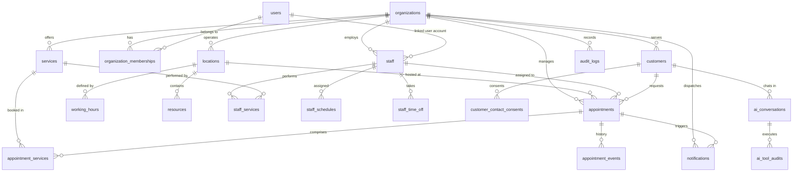

# BookPilot AI — Database Data Model & Schema Specifications

> **Document Version:** 1.0  
> **Phase:** Phase 0 (Discovery & Specification)  
> **Target Database:** PostgreSQL 15+ (Hosted on Supabase)  
> **Governing Standards:** [AGENTS.md](file:///c:/laragon/www/Ai%20Salon%20software/AGENTS.md) & [BOOKPILOT_PROJECT_MASTER_PLAN.md](file:///c:/laragon/www/Ai%20Salon%20software/BOOKPILOT_PROJECT_MASTER_PLAN.md)

---

## 1. Entity-Relationship Overview



---

## 2. Core Schema Entity Definitions

### 2.1 Multi-Tenancy, Users & Access Control

#### `organizations` (Tenants)
The root business entity representing an independent salon, barbershop, or service business.
```sql
CREATE TABLE organizations (
    id UUID PRIMARY KEY DEFAULT gen_random_uuid(),
    name VARCHAR(255) NOT NULL,
    slug VARCHAR(100) NOT NULL UNIQUE,
    brand_logo_url TEXT,
    currency VARCHAR(3) NOT NULL DEFAULT 'GBP',  -- ISO 4217 currency code
    default_locale VARCHAR(10) NOT NULL DEFAULT 'en-GB',
    plan_tier VARCHAR(50) NOT NULL DEFAULT 'trial', -- trial, starter, ai_chat, voice_pro
    subscription_status VARCHAR(50) NOT NULL DEFAULT 'active', -- active, past_due, canceled
    created_at TIMESTAMPTZ NOT NULL DEFAULT NOW(),
    updated_at TIMESTAMPTZ NOT NULL DEFAULT NOW()
);
CREATE INDEX idx_organizations_slug ON organizations (slug);
```

#### `users`
Authenticated system users (business owners, managers, stylists, platform administrators).
```sql
CREATE TABLE users (
    id UUID PRIMARY KEY, -- Maps directly to auth.users.id in Supabase
    email VARCHAR(255) NOT NULL UNIQUE,
    full_name VARCHAR(255) NOT NULL,
    phone VARCHAR(50),
    avatar_url TEXT,
    is_platform_admin BOOLEAN NOT NULL DEFAULT FALSE,
    created_at TIMESTAMPTZ NOT NULL DEFAULT NOW(),
    updated_at TIMESTAMPTZ NOT NULL DEFAULT NOW()
);
```

#### `organization_memberships`
Role assignments linking users to businesses. Supports multi-tenant scoping.
```sql
CREATE TYPE membership_role AS ENUM (
    'business_owner',
    'manager_receptionist',
    'staff_member'
);

CREATE TABLE organization_memberships (
    id UUID PRIMARY KEY DEFAULT gen_random_uuid(),
    organization_id UUID NOT NULL REFERENCES organizations(id) ON DELETE CASCADE,
    user_id UUID NOT NULL REFERENCES users(id) ON DELETE CASCADE,
    role membership_role NOT NULL DEFAULT 'staff_member',
    is_active BOOLEAN NOT NULL DEFAULT TRUE,
    created_at TIMESTAMPTZ NOT NULL DEFAULT NOW(),
    updated_at TIMESTAMPTZ NOT NULL DEFAULT NOW(),
    CONSTRAINT uq_org_user UNIQUE (organization_id, user_id)
);
CREATE INDEX idx_org_memberships_lookup ON organization_memberships (organization_id, user_id);
```

---

### 2.2 Physical Locations & Working Schedules

#### `locations`
Physical shops or operating branches belonging to an organization.
```sql
CREATE TABLE locations (
    id UUID PRIMARY KEY DEFAULT gen_random_uuid(),
    organization_id UUID NOT NULL REFERENCES organizations(id) ON DELETE CASCADE,
    name VARCHAR(255) NOT NULL,
    address_line_1 VARCHAR(255) NOT NULL,
    address_line_2 VARCHAR(255),
    city VARCHAR(100) NOT NULL,
    postal_code VARCHAR(30) NOT NULL,
    country_code VARCHAR(2) NOT NULL DEFAULT 'GB', -- ISO 3166-1 alpha-2
    timezone VARCHAR(100) NOT NULL DEFAULT 'Europe/London', -- IANA Timezone Identifier
    phone VARCHAR(50),
    email VARCHAR(255),
    slot_interval_minutes INT NOT NULL DEFAULT 15,
    min_lead_time_hours INT NOT NULL DEFAULT 2,
    max_advance_booking_days INT NOT NULL DEFAULT 60,
    cancellation_deadline_hours INT NOT NULL DEFAULT 24,
    created_at TIMESTAMPTZ NOT NULL DEFAULT NOW(),
    updated_at TIMESTAMPTZ NOT NULL DEFAULT NOW()
);
CREATE INDEX idx_locations_organization ON locations (organization_id);
```

#### `working_hours`
Standard weekly operating hours for a location (0 = Sunday, 1 = Monday, ..., 6 = Saturday).
```sql
CREATE TABLE working_hours (
    id UUID PRIMARY KEY DEFAULT gen_random_uuid(),
    location_id UUID NOT NULL REFERENCES locations(id) ON DELETE CASCADE,
    day_of_week SMALLINT NOT NULL CHECK (day_of_week BETWEEN 0 AND 6),
    open_time TIME NOT NULL,
    close_time TIME NOT NULL,
    is_closed BOOLEAN NOT NULL DEFAULT FALSE,
    CONSTRAINT check_working_time_order CHECK (close_time > open_time OR is_closed = TRUE),
    CONSTRAINT uq_location_day UNIQUE (location_id, day_of_week)
);
```

---

### 2.3 Staff, Services & Capabilities

#### `staff`
Service providers (barbers, stylists, technicians) available for booking.
```sql
CREATE TABLE staff (
    id UUID PRIMARY KEY DEFAULT gen_random_uuid(),
    organization_id UUID NOT NULL REFERENCES organizations(id) ON DELETE CASCADE,
    location_id UUID NOT NULL REFERENCES locations(id) ON DELETE CASCADE,
    user_id UUID REFERENCES users(id) ON DELETE SET NULL, -- Nullable if staff does not have system login
    first_name VARCHAR(100) NOT NULL,
    last_name VARCHAR(100) NOT NULL,
    display_name VARCHAR(150),
    email VARCHAR(255),
    phone VARCHAR(50),
    avatar_url TEXT,
    is_active BOOLEAN NOT NULL DEFAULT TRUE,
    display_order INT NOT NULL DEFAULT 0,
    created_at TIMESTAMPTZ NOT NULL DEFAULT NOW(),
    updated_at TIMESTAMPTZ NOT NULL DEFAULT NOW()
);
CREATE INDEX idx_staff_org_location ON staff (organization_id, location_id);
```

#### `services`
Treatments and services offered by the business.
```sql
CREATE TABLE services (
    id UUID PRIMARY KEY DEFAULT gen_random_uuid(),
    organization_id UUID NOT NULL REFERENCES organizations(id) ON DELETE CASCADE,
    name VARCHAR(255) NOT NULL,
    description TEXT,
    category VARCHAR(100) NOT NULL DEFAULT 'General',
    duration_minutes INT NOT NULL CHECK (duration_minutes > 0),
    buffer_before_minutes INT NOT NULL DEFAULT 0 CHECK (buffer_before_minutes >= 0),
    buffer_after_minutes INT NOT NULL DEFAULT 0 CHECK (buffer_after_minutes >= 0),
    price DECIMAL(10, 2) NOT NULL CHECK (price >= 0),
    is_active BOOLEAN NOT NULL DEFAULT TRUE,
    display_order INT NOT NULL DEFAULT 0,
    created_at TIMESTAMPTZ NOT NULL DEFAULT NOW(),
    updated_at TIMESTAMPTZ NOT NULL DEFAULT NOW()
);
CREATE INDEX idx_services_org ON services (organization_id);
```

#### `staff_services`
Qualification junction table defining which staff can perform which services (and optional staff-specific prices/durations).
```sql
CREATE TABLE staff_services (
    staff_id UUID NOT NULL REFERENCES staff(id) ON DELETE CASCADE,
    service_id UUID NOT NULL REFERENCES services(id) ON DELETE CASCADE,
    custom_price DECIMAL(10, 2), -- Overrides service base price if present
    custom_duration_minutes INT, -- Overrides service base duration if present
    created_at TIMESTAMPTZ NOT NULL DEFAULT NOW(),
    PRIMARY KEY (staff_id, service_id)
);
```

#### `staff_schedules` & `staff_time_off`
Staff regular shifts, recurring breaks, and approved vacation/sick leave.
```sql
CREATE TABLE staff_schedules (
    id UUID PRIMARY KEY DEFAULT gen_random_uuid(),
    staff_id UUID NOT NULL REFERENCES staff(id) ON DELETE CASCADE,
    day_of_week SMALLINT NOT NULL CHECK (day_of_week BETWEEN 0 AND 6),
    start_time TIME NOT NULL,
    end_time TIME NOT NULL,
    break_start TIME,
    break_end TIME,
    is_working BOOLEAN NOT NULL DEFAULT TRUE,
    CONSTRAINT check_shift_time_order CHECK (end_time > start_time OR is_working = FALSE),
    CONSTRAINT uq_staff_day UNIQUE (staff_id, day_of_week)
);

CREATE TABLE staff_time_off (
    id UUID PRIMARY KEY DEFAULT gen_random_uuid(),
    staff_id UUID NOT NULL REFERENCES staff(id) ON DELETE CASCADE,
    reason VARCHAR(255),
    start_date TIMESTAMPTZ NOT NULL,
    end_date TIMESTAMPTZ NOT NULL,
    CONSTRAINT check_time_off_range CHECK (end_date > start_date)
);
CREATE INDEX idx_staff_time_off_range ON staff_time_off (staff_id, start_date, end_date);
```

#### `resources`
Optional rooms, styling chairs, or specialized equipment required for certain services.
```sql
CREATE TABLE resources (
    id UUID PRIMARY KEY DEFAULT gen_random_uuid(),
    organization_id UUID NOT NULL REFERENCES organizations(id) ON DELETE CASCADE,
    location_id UUID NOT NULL REFERENCES locations(id) ON DELETE CASCADE,
    name VARCHAR(255) NOT NULL,
    resource_type VARCHAR(100) NOT NULL,
    quantity INT NOT NULL DEFAULT 1,
    is_active BOOLEAN NOT NULL DEFAULT TRUE,
    created_at TIMESTAMPTZ NOT NULL DEFAULT NOW()
);
```

---

### 2.4 Customers & Consent Tracking

#### `customers`
Clients of the salon. Distinct per organization (tenant-isolated).
```sql
CREATE TABLE customers (
    id UUID PRIMARY KEY DEFAULT gen_random_uuid(),
    organization_id UUID NOT NULL REFERENCES organizations(id) ON DELETE CASCADE,
    first_name VARCHAR(100) NOT NULL,
    last_name VARCHAR(100) NOT NULL,
    email VARCHAR(255) NOT NULL,
    phone VARCHAR(50) NOT NULL,
    notes TEXT,
    created_at TIMESTAMPTZ NOT NULL DEFAULT NOW(),
    updated_at TIMESTAMPTZ NOT NULL DEFAULT NOW(),
    CONSTRAINT uq_org_customer_email UNIQUE (organization_id, email)
);
CREATE INDEX idx_customers_org_phone ON customers (organization_id, phone);
```

#### `customer_contact_consents`
Audit trail of GDPR / privacy consent for SMS, WhatsApp, and marketing notifications.
```sql
CREATE TABLE customer_contact_consents (
    id UUID PRIMARY KEY DEFAULT gen_random_uuid(),
    customer_id UUID NOT NULL REFERENCES customers(id) ON DELETE CASCADE,
    channel VARCHAR(50) NOT NULL, -- email, sms, whatsapp
    consent_given BOOLEAN NOT NULL,
    ip_address VARCHAR(45),
    user_agent TEXT,
    consented_at TIMESTAMPTZ NOT NULL DEFAULT NOW()
);
```

---

### 2.5 Appointments, Multi-Service Booking & Concurrency Engine

#### `appointments`
The central booking record.
```sql
CREATE TYPE appointment_status AS ENUM (
    'pending_hold',
    'confirmed',
    'completed',
    'cancelled',
    'no_show',
    'expired'
);

CREATE TABLE appointments (
    id UUID PRIMARY KEY DEFAULT gen_random_uuid(),
    organization_id UUID NOT NULL REFERENCES organizations(id) ON DELETE CASCADE,
    location_id UUID NOT NULL REFERENCES locations(id) ON DELETE RESTRICT,
    customer_id UUID NOT NULL REFERENCES customers(id) ON DELETE RESTRICT,
    staff_id UUID NOT NULL REFERENCES staff(id) ON DELETE RESTRICT,
    booking_reference VARCHAR(12) NOT NULL UNIQUE, -- Human readable reference e.g. "BP-83921"
    status appointment_status NOT NULL DEFAULT 'confirmed',
    start_time TIMESTAMPTZ NOT NULL,
    end_time TIMESTAMPTZ NOT NULL,
    total_price DECIMAL(10, 2) NOT NULL CHECK (total_price >= 0),
    currency VARCHAR(3) NOT NULL DEFAULT 'GBP',
    notes TEXT,
    cancellation_reason TEXT,
    hold_expires_at TIMESTAMPTZ, -- Active during pending_hold reservation states
    created_channel VARCHAR(50) NOT NULL DEFAULT 'web', -- web, ai_chat, whatsapp, phone, manual_dashboard
    idempotency_key VARCHAR(255) UNIQUE, -- Prevents duplicate booking creation on network retry
    created_at TIMESTAMPTZ NOT NULL DEFAULT NOW(),
    updated_at TIMESTAMPTZ NOT NULL DEFAULT NOW(),
    CONSTRAINT check_appointment_times CHECK (end_time > start_time)
);

CREATE INDEX idx_appointments_org_date ON appointments (organization_id, start_time);
CREATE INDEX idx_appointments_staff_date ON appointments (staff_id, start_time, end_time);
CREATE INDEX idx_appointments_customer ON appointments (customer_id);
```

#### Concurrency Exclusion Constraint (PostgreSQL GIST)
To guarantee that two concurrent transactions cannot create overlapping bookings for the same staff member:
```sql
-- Requires extension btree_gist
CREATE EXTENSION IF NOT EXISTS btree_gist;

ALTER TABLE appointments
ADD CONSTRAINT prevent_staff_appointment_overlap
EXCLUDE USING gist (
    staff_id WITH =,
    tstzrange(start_time, end_time) WITH &&
) WHERE (status IN ('confirmed', 'pending_hold'));
```

#### `appointment_services`
Services included within an appointment (supports compound/multi-service appointments).
```sql
CREATE TABLE appointment_services (
    id UUID PRIMARY KEY DEFAULT gen_random_uuid(),
    appointment_id UUID NOT NULL REFERENCES appointments(id) ON DELETE CASCADE,
    service_id UUID NOT NULL REFERENCES services(id) ON DELETE RESTRICT,
    duration_minutes INT NOT NULL,
    price DECIMAL(10, 2) NOT NULL,
    sort_order INT NOT NULL DEFAULT 0
);
CREATE INDEX idx_appointment_services ON appointment_services (appointment_id);
```

#### `appointment_events`
Immutable historical event ledger recording state transitions and actions.
```sql
CREATE TABLE appointment_events (
    id UUID PRIMARY KEY DEFAULT gen_random_uuid(),
    appointment_id UUID NOT NULL REFERENCES appointments(id) ON DELETE CASCADE,
    actor_id UUID, -- NULL if customer/AI or references users(id)
    actor_type VARCHAR(50) NOT NULL, -- system, customer, ai_receptionist, staff, owner
    event_type VARCHAR(50) NOT NULL, -- created, confirmed, rescheduled, cancelled, no_show_marked
    metadata JSONB NOT NULL DEFAULT '{}'::jsonb,
    created_at TIMESTAMPTZ NOT NULL DEFAULT NOW()
);
CREATE INDEX idx_appointment_events ON appointment_events (appointment_id);
```

---

### 2.6 AI Receptionist Audit & Handoff Tables

#### `ai_conversations`
Tracks conversational sessions across Web Chat, WhatsApp, or Voice.
```sql
CREATE TABLE ai_conversations (
    id UUID PRIMARY KEY DEFAULT gen_random_uuid(),
    organization_id UUID NOT NULL REFERENCES organizations(id) ON DELETE CASCADE,
    channel VARCHAR(50) NOT NULL, -- web_chat, whatsapp, phone
    session_identifier VARCHAR(255) NOT NULL, -- e.g. anonymous cookie ID or caller phone number
    customer_id UUID REFERENCES customers(id) ON DELETE SET NULL,
    status VARCHAR(50) NOT NULL DEFAULT 'active', -- active, completed, escalated_to_human
    escalation_reason TEXT,
    created_at TIMESTAMPTZ NOT NULL DEFAULT NOW(),
    updated_at TIMESTAMPTZ NOT NULL DEFAULT NOW()
);
CREATE INDEX idx_ai_conversations_org ON ai_conversations (organization_id, session_identifier);
```

#### `ai_tool_audits`
Mandatory explainable audit log of every deterministic tool call initiated by the AI model.
```sql
CREATE TABLE ai_tool_audits (
    id UUID PRIMARY KEY DEFAULT gen_random_uuid(),
    conversation_id UUID NOT NULL REFERENCES ai_conversations(id) ON DELETE CASCADE,
    tool_name VARCHAR(100) NOT NULL,
    input_parameters JSONB NOT NULL,
    output_result JSONB NOT NULL,
    execution_status VARCHAR(50) NOT NULL, -- success, validation_error, rejected_policy, conflict
    execution_time_ms INT NOT NULL,
    created_at TIMESTAMPTZ NOT NULL DEFAULT NOW()
);
CREATE INDEX idx_ai_tool_audits_conversation ON ai_tool_audits (conversation_id);
```

---

### 2.7 Notifications & Background Jobs

#### `notifications` & `notification_attempts`
Manages transactional confirmation and reminder emails with durable retry logging.
```sql
CREATE TABLE notifications (
    id UUID PRIMARY KEY DEFAULT gen_random_uuid(),
    organization_id UUID NOT NULL REFERENCES organizations(id) ON DELETE CASCADE,
    appointment_id UUID REFERENCES appointments(id) ON DELETE CASCADE,
    channel VARCHAR(50) NOT NULL DEFAULT 'email', -- email, sms, whatsapp
    recipient VARCHAR(255) NOT NULL,
    template_type VARCHAR(100) NOT NULL, -- booking_confirmation, reminder_24h, cancellation_notice
    status VARCHAR(50) NOT NULL DEFAULT 'queued', -- queued, sent, failed, exhausted
    scheduled_for TIMESTAMPTZ NOT NULL DEFAULT NOW(),
    created_at TIMESTAMPTZ NOT NULL DEFAULT NOW()
);

CREATE TABLE notification_attempts (
    id UUID PRIMARY KEY DEFAULT gen_random_uuid(),
    notification_id UUID NOT NULL REFERENCES notifications(id) ON DELETE CASCADE,
    attempt_number INT NOT NULL,
    provider VARCHAR(50) NOT NULL DEFAULT 'resend',
    provider_response_id VARCHAR(255),
    error_message TEXT,
    attempted_at TIMESTAMPTZ NOT NULL DEFAULT NOW()
);
CREATE INDEX idx_notifications_status ON notifications (status, scheduled_for);
```

---

### 2.8 Audit Logging

#### `audit_logs`
System-wide security and administrative action ledger.
```sql
CREATE TABLE audit_logs (
    id UUID PRIMARY KEY DEFAULT gen_random_uuid(),
    organization_id UUID NOT NULL REFERENCES organizations(id) ON DELETE CASCADE,
    user_id UUID, -- Actor user ID
    action VARCHAR(100) NOT NULL, -- e.g. "service.created", "staff.deleted", "booking.cancelled"
    entity_type VARCHAR(50) NOT NULL,
    entity_id UUID NOT NULL,
    changes JSONB,
    ip_address VARCHAR(45),
    created_at TIMESTAMPTZ NOT NULL DEFAULT NOW()
);
CREATE INDEX idx_audit_logs_org ON audit_logs (organization_id, created_at);
```

---

## 3. Data Integrity & Migration Strategy

1. **Version Controlled Migrations**: All schema modifications are committed to `supabase/migrations/<timestamp>_<descriptive_name>.sql`.
2. **Deterministic Down-Migrations**: Every migration file must include a verified rollback counterpart.
3. **Foreign Key Integrity**: Cascade rules are explicit: child records within a tenant (e.g. services, staff) cascade on organization deletion; financial and appointment records (`appointments`, `appointment_events`) use `RESTRICT` to prevent accidental loss of operational history.
4. **Idempotent Operations**: Booking creation accepts a unique `idempotency_key` to safeguard against duplicate bookings resulting from network dropouts or user re-clicks.
